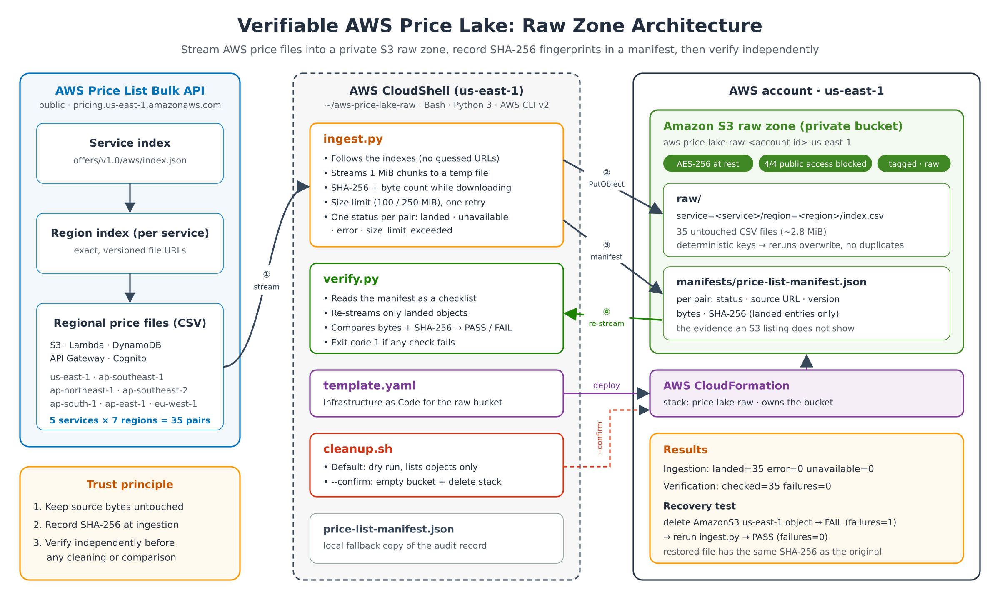

# 🔐 Verifiable AWS Price Lake: Raw Zone

A private Amazon S3 raw data zone that collects AWS price files across **5 services × 7 regions** and proves their integrity with **SHA-256 fingerprints**, an audit **manifest**, and an **independent verifier**.

> Built as Project 1 of the Regional Price Lake series on [NextWork](https://nextwork.ai/projects/adcc9776-8667-4193-9ccd-a9e9f9917489).
> AWS Student Builders Group – TIP (QC) · Skill Builders Department · Data Science

---

## 🎯 Why this project?
Price comparisons can look precise while relying on source files that changed or went missing. This project keeps the **original, untouched files** together with a **manifest** that records each file's source, version, size, and SHA-256 hash, so the data can be **proven unchanged** before any cleaning or analysis.

---

## 🏗️ System architecture



**How data flows:**
1. **Discover + stream:** `ingest.py` reads the AWS Price List **service index**, then each service's **region index**, to find the exact versioned CSV URL (no guessed paths). It streams each file in 1 MiB chunks into a bounded temp file.
2. **Fingerprint + land:** while downloading, it computes the **SHA-256 hash** and byte count. Only a complete file within the size limit is uploaded to S3 with `PutObject`, so no partial objects are created.
3. **Record:** every service-region pair gets exactly one status (`landed`, `unavailable`, `error`, `size_limit_exceeded`) in `manifests/price-list-manifest.json`, with a local fallback copy.
4. **Verify:** `verify.py` treats the manifest as a checklist, re-streams every `landed` object from S3, and checks that bytes and SHA-256 still match → `PASS` / `FAIL`, with exit code `1` on any failure.

**Infrastructure:** `template.yaml` deploys the bucket through the AWS CloudFormation stack `price-lake-raw`: AES-256 encryption at rest, all four public access blocks enabled, and project tags. `cleanup.sh` is a dry run by default and only deletes with `--confirm`.

---

## 📁 Files
| File | Purpose |
|---|---|
| `template.yaml` | CloudFormation template: private S3 bucket with AES-256 encryption and all 4 public access blocks |
| `ingest.py` | Index-driven ingestion: downloads each file, records SHA-256 + bytes, uploads to S3, writes the manifest |
| `verify.py` | Independent verifier: re-streams every landed object and compares it with the manifest |
| `cleanup.sh` | Guarded cleanup: dry run by default, deletes the bucket contents and stack only with `--confirm` |
| `price-list-manifest.json` | The audit record from my run (35 entries) |
| `docs/architecture.png` | System architecture diagram (`.svg` source included) |

---

## 📊 Results
- **Services:** AmazonS3, AWSLambda, AmazonDynamoDB, AmazonApiGateway, AmazonCognito
- **Regions:** us-east-1, ap-southeast-1, ap-northeast-1, ap-southeast-2, ap-south-1, ap-east-1, eu-west-1
- **Ingestion:** `SUMMARY landed=35 unavailable=0 error=0 size_limit_exceeded=0`
- **Verification:** `VERIFY SUMMARY checked=35 failures=0`
- **Storage:** 36 objects (35 price files + 1 manifest), about 2.8 MiB

---

## 💎 Recovery test
1. Deleted `raw/service=AmazonS3/region=us-east-1/index.csv` on purpose (manifest left unchanged).
2. The verifier caught it: `FAIL service=AmazonS3 region=us-east-1` → `failures=1` (exit code 1).
3. Reran `ingest.py`, which restored the file to the same deterministic S3 key.
4. The verifier confirmed recovery: `failures=0`. The restored file had the **same SHA-256 hash** as the original.

---

## ▶️ How to run (AWS CloudShell, us-east-1)
```bash
# 1. Deploy the private raw bucket
aws cloudformation deploy --template-file template.yaml --stack-name price-lake-raw --region us-east-1 --tags Project=aws-price-lake

# 2. Set the bucket name
ACCOUNT_ID=$(aws sts get-caller-identity --query Account --output text)
BUCKET="aws-price-lake-raw-${ACCOUNT_ID}-us-east-1"

# 3. Ingest (try --sample first for one pair; --max-file-mb raises the size limit)
python3 ingest.py --bucket "$BUCKET" --sample
python3 ingest.py --bucket "$BUCKET"

# 4. Verify every landed object
python3 verify.py --bucket "$BUCKET"

# 5. Cleanup rehearsal (add --confirm only when you really want to delete)
bash cleanup.sh
```

---

## 🧠 What I learned
- **Infrastructure as Code** with AWS CloudFormation
- **Raw data zones:** keep source bytes untouched before any processing
- **SHA-256 hashing** as a file fingerprint for integrity checks
- **Manifests** as audit records that an S3 listing alone doesn't show
- **Resilient pipelines:** index discovery, bounded downloads, one retry, and clear statuses so one failure doesn't stop the run
- **Independent verification** and **exit codes** for automation
- **Recovery testing:** break it on purpose to prove it can be repaired
- **Debugging Python indentation:** a misplaced block made the summary print 35 times

---

## 🛠️ Tools
AWS CloudShell · AWS CloudFormation · Amazon S3 · AWS CLI v2 · Python 3 · AWS Price List Bulk API

---

👤 **James Andre L. Kalaw**
